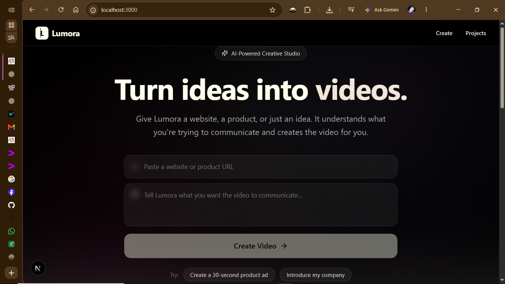
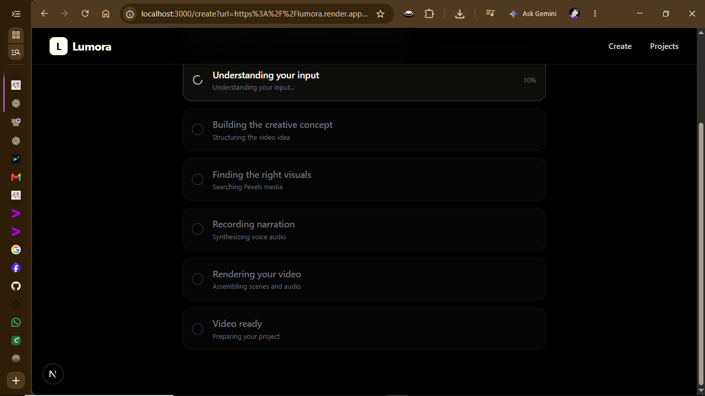
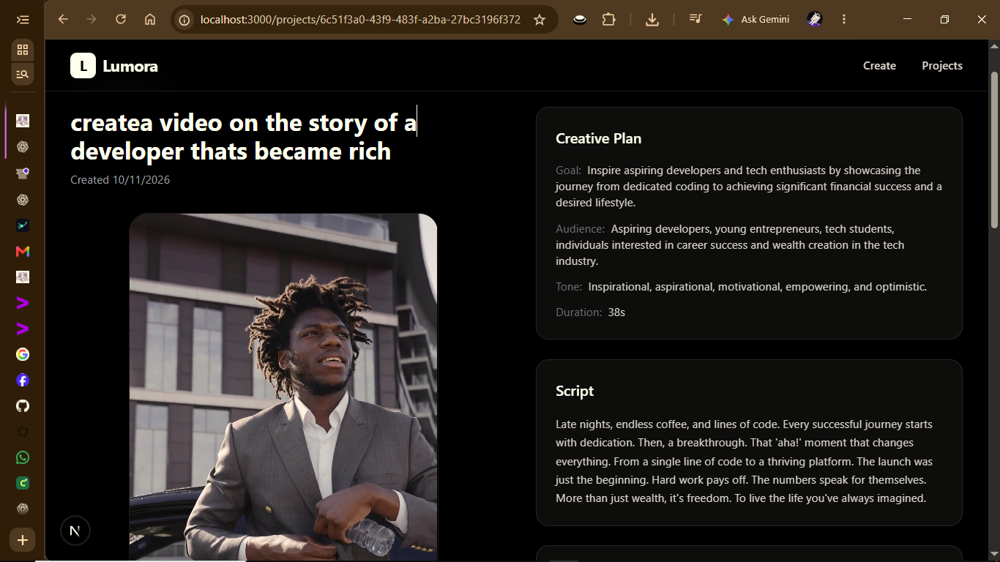

<div align="center">

# Lumora AI

**Turn a website, a product, or a plain idea into a finished vertical video.**

[](https://www.typescriptlang.org/)
[](https://nextjs.org/)
[](https://tailwindcss.com/)
[](https://ffmpeg.org/)
[](#license)

<p>
  <a href="#-interactive-demo">Interactive demo</a> ·
  <a href="#-example-output">Example output</a> ·
  <a href="#-deploy-to-render">Deploy to Render</a>
</p>

</div>

---

## What it does

Lumora takes a **URL** or a **text idea** and runs a fully automated production pipeline:

```
Idea or URL
   │
   ├─► 1. Ingest       pull readable text out of the page (or use raw text)
   ├─► 2. Plan         Gemini builds a creative brief, script and scene breakdown
   ├─► 3. Visuals      Pexels finds a real photo or video for every scene
   ├─► 4. Narration    Piper (local TTS) records each scene's voice-over
   ├─► 5. Subtitles    An .srt is generated from the narration and burned into the frames
   ├─► 6. Music        A mood-matched track is trimmed, faded and mixed underneath
   └─► 7. Render       FFmpeg assembles everything into a 1080×1920 MP4
```

The output is a real, playable, **9:16 vertical MP4** with visuals, narration, captions
and background music — ready for Reels, Shorts or TikTok.

No timeline. No editor. No manual work.

---

## Interactive demo

> **Watch Lumora run end to end, with the UI, in your browser:**

<div align="center">

### [▶ Click here to open the interactive walkthrough](https://app.arcade.software/share/EGNtrTpGzBfmLvAvavbS)

</div>

The clip above walks through pasting an idea, generating the plan, and watching the
finished video appear — including the caption and music mix.

---

## Example output

A real video generated end to end by Lumora — visuals, narration, burned-in captions and
background music.

<div align="center">

<table>
<tr>
<td align="center" width="340">
<video src="https://raw.githubusercontent.com/legendONE382/lumora-/main/public/demo/example.mp4" width="300" controls poster="docs/screenshot-video.png"></video>
<br />
<sub><b>Generated by Lumora</b></sub>
</td>
</tr>
</table>

<sub>1080 × 1920 · vertical · H.264 + AAC</sub>

<br />

The same file lives in the repo at
[`public/demo/example.mp4`](public/demo/example.mp4) and is served on the landing page at `/demo/example.mp4`.

</div>

---

## Screenshots

<div align="center">

### Landing page


<br />

### Video generation in progress


<br />

### Finished video with burned-in captions


</div>

---

## Core features

| | |
|---|---|
| **AI creative direction** | Turns a URL or a sentence into a structured scene-by-scene plan with a script, tone and per-scene search queries. Gemini failures degrade gracefully to a built-in local plan instead of crashing. |
| **Real stock visuals** | Pexels search for photos *and* videos per scene, run concurrently. Up to three queries per scene with semantic fallbacks, and in-run caching so the same query is never fetched twice. |
| **Local, free narration** | [Piper](https://github.com/rhasspy/piper) TTS runs entirely on your machine — one WAV per scene, no API cost, no vendor lock-in. |
| **Burned-in captions** | Subtitles are generated from the narration text and its timing, then rendered straight into the pixels with FFmpeg's `subtitles` filter. They survive every player and every re-upload. |
| **Background music** | The plan's tone selects a mood folder (`luxury`, `cinematic`, `dramatic`, `energetic`, `corporate`), a track is picked at random, then trimmed, faded in/out and mixed quietly under the narration. |
| **Vertical by default** | Everything normalises to `1080×1920` at 30 fps with `yuv420p` and `+faststart` for instant progressive playback. |
| **Resilient rendering** | A scene that finds no media still renders (as a clean black clip) rather than aborting the whole video. |

---

## Tech stack

| Layer | Technology |
| --- | --- |
| Frontend | Next.js 16 (App Router), React 19, TypeScript 5, Tailwind CSS 4 |
| AI planning | Google Generative AI — `gemini-2.5-flash` with structured output |
| Visuals | [Pexels](https://www.pexels.com/api/) Photos & Videos API |
| Narration | Piper TTS (local Python, offline) |
| Video assembly | FFmpeg — invoked from Node via `child_process` |
| Deployment | Docker on [Render](https://render.com) |

**Only two external providers are used: Gemini and Pexels.** Everything else — text-to-speech,
subtitle rendering, video encoding — runs locally and is free.

---

## Prerequisites

- **Node.js 20+** and npm
- **FFmpeg** on your `PATH`, built with **libass** (required for the `subtitles` filter)
- **Python 3** with `piper-tts` installed
- A **Piper voice model** — `en_US-amy-medium.onnx` and its `.onnx.json` config, committed in [`voices/`](voices/)
- API keys for **Gemini** and **Pexels**

---

## Local setup

```bash
# 1. Clone
git clone https://github.com/legendONE382/lumora-.git
cd lumora-

# 2. Install dependencies
npm install

# 3. Configure environment
cp .env.local.example .env.local
#    then edit .env.local and fill in GEMINI_API_KEY and PEXELS_API_KEY

# 4. Run
npm run dev
```

Open <http://localhost:3000>.

The Piper voice model is already committed under `voices/`, so narration works out of the box.
If you keep your models elsewhere, point `PIPER_VOICE_DIR` at that folder.

### Verifying your toolchain

```bash
# FFmpeg must support the subtitles filter (libass)
ffmpeg -hide_banner -filters | grep subtitles

# Piper must be importable as a module
python -m piper --help
```

---

## Environment variables

See [`.env.local.example`](.env.local.example) for the full, commented list.

**Required**

| Variable | Purpose |
| --- | --- |
| `GEMINI_API_KEY` | Creative plan and script generation. If unset, Lumora falls back to a built-in local plan rather than failing. |
| `PEXELS_API_KEY` | Stock photo/video search, used to source real scene media. |

<sub>The legacy misspelling `PEXELES_API_KEY` is still accepted as a fallback for backwards compatibility.</sub>

**Optional**

| Variable | Default | Purpose |
| --- | --- | --- |
| `PIPER_BINARY` | `python` (Win) / `python3` | Python interpreter that has `piper-tts` installed |
| `PIPER_VOICE_DIR` | `./voices` | Folder containing the voice model |
| `PIPER_MODEL` | `en_US-amy-medium` | Voice name, without extension |
| `FFMPEG_BINARY` | `ffmpeg` | Custom path to the FFmpeg binary |
| `NEXT_PUBLIC_APP_URL` | `http://localhost:3000` | Public URL, used for metadata and absolute links |

Never commit `.env.local` — it is git-ignored by design.

---

## Deploy to Render

Lumora ships as a **Docker** web service. The image bundles FFmpeg (with libass), fonts,
Python and `piper-tts`, so nothing extra needs to be installed on the host.

### Blueprint deploy (recommended)

[`render.yaml`](render.yaml) is included:

1. Push this repository to GitHub.
2. In the [Render dashboard](https://dashboard.render.com): **New → Blueprint** and pick this repo.
3. Fill in the two secret values when prompted — `GEMINI_API_KEY` and `PEXELS_API_KEY`.
4. Deploy.

Render reads `Dockerfile` at the repo root and starts the service with `npm start`.

### Manual web service

| Setting | Value |
| --- | --- |
| Runtime | **Docker** |
| Dockerfile path | `./Dockerfile` |
| Docker build context | `.` |
| Health check path | `/` |
| Region | any (Oregon in the blueprint) |

Then add `GEMINI_API_KEY` and `PEXELS_API_KEY` as environment variables.

### What the image guarantees

The `Dockerfile` fails the build loudly if FFmpeg was compiled without the `subtitles`
filter, so a broken render environment can never reach production silently.

### Persisting generated videos

Generated media is written to `tmp/`, which is **ephemeral** on Render — redeploys wipe it.
That is fine for demos. To keep projects across deploys, uncomment the `disks:` block in
[`render.yaml`](render.yaml) and mount a paid Render Disk at `/app/tmp`.

---

## Project structure

```
app/
  api/
    extract/          URL/text ingestion; creates the project
    generate-plan/    Gemini creative plan
    generate-visual/  Pexels scene media search + download
    generate-audio/   Piper narration generation
    render-video/     FFmpeg video assembly (+ music + subtitles)
    video/[id]/       Final MP4 serving route
    projects/[id]/    Project detail API
  create/             Creation workspace — runs the pipeline from the browser
  projects/           Project list page
  projects/[id]/      Project detail page
  page.tsx            Landing page (with the example video)
  layout.tsx          Root layout, metadata and Open Graph tags
components/
  Header.tsx          Site header with responsive nav
  Hero.tsx            Landing hero + idea/URL input form
  ExampleVideo.tsx    Landings-page 9:16 demo player
  ProjectCard.tsx     Project card
  VideoPlayer.tsx     Project video player with loading/error states
lib/
  ai/gemini.ts        Gemini client, structured plan + graceful fallback
  audio/piper.ts      Piper TTS runner
  ingestion/extractor.ts  URL/text extractor
  media/pexels.ts     Pexels client, candidate scoring and download
  projects/storage.ts        Project persistence (server Map / localStorage)
  projects/server-store.ts   File-backed server project store
  video/
    ffmpeg.ts         Scene clips, concat, music mix and subtitle burn-in
    subtitles.ts      SRT generation and timing
types/index.ts        Shared TypeScript types
voices/               Piper narration model (en_US-amy-medium)
public/demo/          Example output video served on the landing page
docs/                 README screenshots
```

---

## How the pipeline works

`app/create/page.tsx` drives the stages in sequence and reports live progress:

1. **`/api/extract`** — scrapes the URL (title, meta description, cleaned body text) or takes raw text, then creates and stores a `Project`.
2. **`/api/generate-plan`** — sends the input to Gemini with a response schema, retries on rate limits, and normalises the result. Falls back to a local plan when Gemini is unavailable.
3. **`/api/generate-visual`** — for each scene, searches Pexels **photos and videos concurrently** across up to three queries (cached within the run), scores candidates, and downloads the best match into `tmp/<projectId>/scene-N/`.
4. **`/api/generate-audio`** — synthesises narration for every scene with Piper and writes `narration-<timestamp>.wav` into the project directory.
5. **`/api/render-video`** — builds the final MP4 and marks the project `completed`.

## How rendering works

`lib/video/ffmpeg.ts` keeps the stages isolated so failures are easy to diagnose:

1. **Scene clips** — each scene is normalised to `1080×1920` at 30 fps. A downloaded video is
   scaled and centre-cropped; a still image gets a slow `zoompan` Ken Burns move; if a scene has
   no media at all, a black clip is produced so the rest of the video still renders. Narration is
   muxed into the clip as AAC whenever present.
2. **Concatenation** — the scene clips are joined into a single video/audio master with FFmpeg's
   `concat` filter.
3. **Subtitles** — an `.srt` is generated from the narration and its timing, then burned into the
   frames with the `subtitles` filter using a modern, high-contrast caption style.
4. **Music** — a mood-matched track is looped to the video length, trimmed, faded in and out,
   held at a low level, and mixed with the narration via `amix` so speech stays clearly dominant.
5. **Output** — written to `tmp/<projectId>/final.mp4` with `+faststart` for progressive playback.

## Browser playback

Finished videos are served by `/api/video/[id]`, which streams the MP4 with
`Content-Type: video/mp4`. The project page resolves the URL and hands it to `<VideoPlayer>`.
Captions are part of the pixels, so playback needs no special player support.

---

## Notes

- Do **not** commit `.env.local` or any file containing real API keys.
- Large generated media lives under `tmp/` and is git-ignored. The demo video under
  `public/demo/` and the Piper model under `voices/` are deliberately committed.
- The server stores are process-bound (an in-memory Map plus a `tmp/server-store.json`
  snapshot), so state can lag across restarts. Add a Render Disk or move to a real database
  if you need durable project history.
- Long FFmpeg renders run inside the HTTP request. `maxDuration = 600` is exported on the
  render route; for heavy traffic, move rendering to a background queue.

## License

MIT
